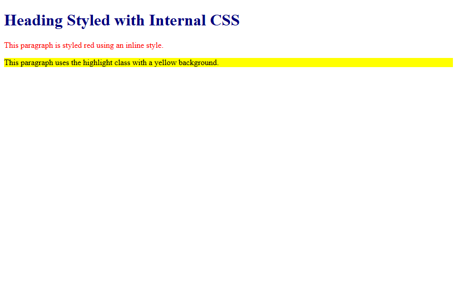
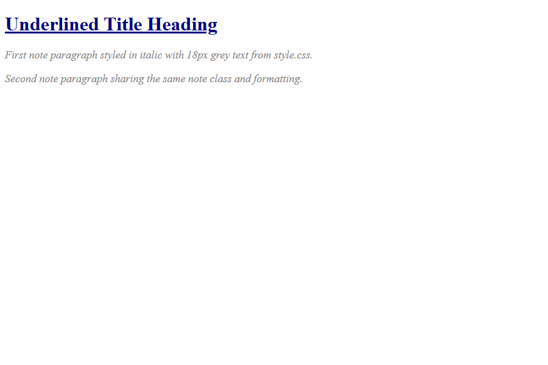

# Assignment 10 - CSS Fundamentals

## 1. Aim
Write styles inline, in a style block in the head, and in an external stylesheet.

## 2. Theoretical Background
- **Three Ways to Apply CSS**:
  - **Inline Styles**: Defined directly within an element's `style` attribute (highest specificity).
  - **Internal Stylesheet**: Defined within a `<style>` block in the document's `<head>`.
  - **External Stylesheet**: Defined in a separate `.css` file and linked via `<link rel="stylesheet">`.
- **CSS Selectors**:
  - Element (Type) selector: Targets tags directly (`body`, `h1`, `p`).

## 3. Tasks Breakdown
- **Task 1 (`inline-internal.html`)**: Two paragraphs. First paragraph styled red via inline style; second paragraph styled blue via internal style sheet in the `<head>`.
- **Task 2 (`style.css`)**: External stylesheet setting `body` font family to `sans-serif` and `h1` color to `darkgreen`.
- **Task 3 (`linked.html`)**: HTML page linking to `style.css` with an `h1` heading and a paragraph to verify both rules take effect.

## 4. Code Listings

### inline-internal.html
```html
<!--
Student Name: Ramandeep Kaur
Roll Number : BCS2025395
Course      : B.Tech CSE - Second Year
Subject     : HTML and CSS Introduction Lab (BCS352)
Assignment  : Assignment 10 - CSS Fundamentals - Task 1
-->
<!DOCTYPE html>
<html lang="en">
<head>
    <meta charset="UTF-8">
    <meta name="viewport" content="width=device-width, initial-scale=1.0">
    <title>Assignment 10 - Inline and Internal CSS</title>
    <style>
        h1 {
            color: navy;
        }
        .highlight {
            background-color: yellow;
        }
    </style>
</head>
<body>
    <h1>Heading Styled with Internal CSS</h1>
    <p style="color: red;">This paragraph is styled red using an inline style.</p>
    <p class="highlight">This paragraph uses the highlight class with a yellow background.</p>
</body>
</html>

```

### linked.html
```html
<!--
Student Name: Ramandeep Kaur
Roll Number : BCS2025395
Course      : B.Tech CSE - Second Year
Subject     : HTML and CSS Introduction Lab (BCS352)
Assignment  : Assignment 10 - CSS Fundamentals - Task 3
-->
<!DOCTYPE html>
<html lang="en">
<head>
    <meta charset="UTF-8">
    <meta name="viewport" content="width=device-width, initial-scale=1.0">
    <title>Assignment 10 - Linked Stylesheet</title>
    <link rel="stylesheet" href="style.css">
</head>
<body>
    <h1 id="title">Underlined Title Heading</h1>
    <p class="note">First note paragraph styled in italic with 18px grey text from style.css.</p>
    <p class="note">Second note paragraph sharing the same note class and formatting.</p>
</body>
</html>

```

### style.css
```css
/*
Student Name: Ramandeep Kaur
Roll Number : BCS2025395
Course      : B.Tech CSE - Second Year
Subject     : HTML and CSS Introduction Lab (BCS352)
Assignment  : Assignment 10 - CSS Fundamentals - Task 2 (style.css)
*/
h1 {
    color: navy;
}

.note {
    font-style: italic;
}

#title {
    text-decoration: underline;
}

p {
    font-size: 18px;
    color: grey;
}

```

## 5. Output Verification

### Task 1: Inline & Internal CSS (`inline-internal.html`)
Browser output comparing red inline styling and blue internal stylesheet:



### Task 2 & 3: External Stylesheet (`linked.html`)
Browser output verifying styling applied from external style.css:



## 6. Conclusion
Demonstrated inline styling, internal stylesheet blocks, and external stylesheets linking rules cleanly to HTML elements.
