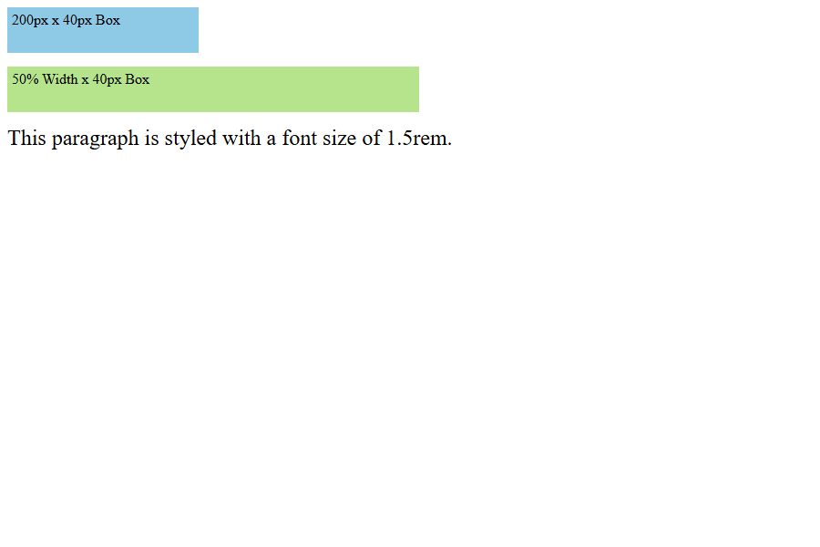
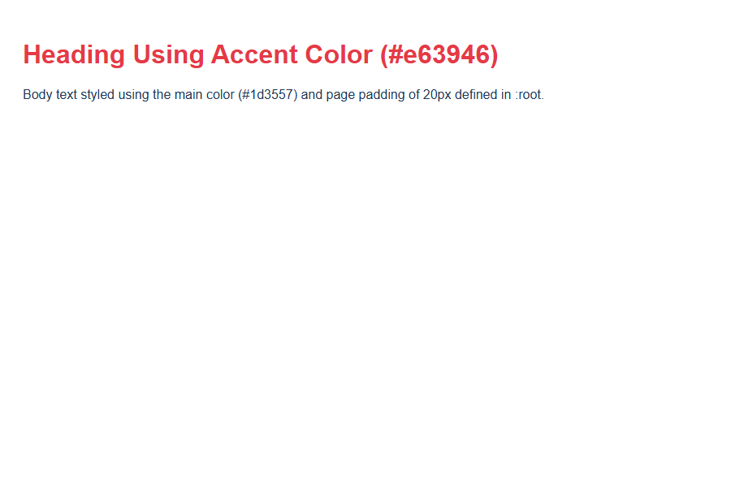
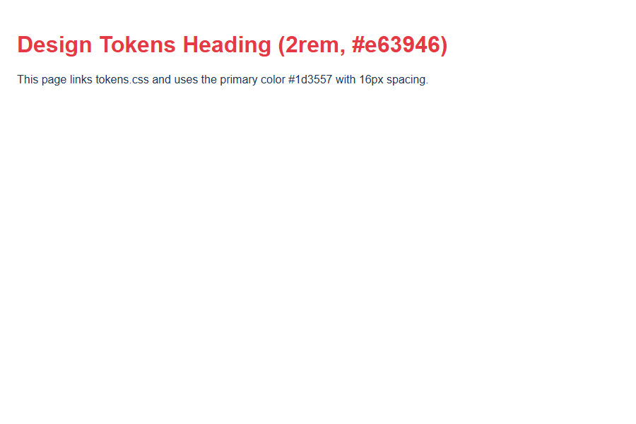

# Assignment 11 - Units and CSS Variables

## 1. Aim
Compare px and %, use rem for text, and share colors with CSS variables.

## 2. Theoretical Background
- **Absolute vs Relative Units**:
  - `px`: Fixed pixel size regardless of parent or viewport.
  - `%`: Relative percentage based on the parent container's dimensions.
  - `rem`: Relative unit based on the root (`<html>`) font size.
- **CSS Custom Properties (Variables)**:
  - Declared on `:root` using `--variable-name: value;`.
  - Accessed across selectors using `var(--variable-name)`.

## 3. Tasks Breakdown
- **Task 1 (`units.html`)**: Two div boxes: one with `width: 300px` and one with `width: 50%`. Inside each, a paragraph with `font-size: 1.2rem`.
- **Task 2 (`variables.html`)**: Defined `--brand-color` (blue) and `--card-padding: 16px` on `:root` and applied them to a card div.
- **Task 3 (`tokens.css` & `tokens.html`)**: Reusable external `tokens.css` with the two variables, linked and used across two different elements.

## 4. Code Listings

### tokens.html
```html
<!--
Student Name: Ramandeep Kaur
Roll Number : BCS2025395
Course      : B.Tech CSE - Second Year
Subject     : HTML and CSS Introduction Lab (BCS352)
Assignment  : Assignment 11 - Units and CSS Variables - Task 3 (tokens.html)
-->
<!DOCTYPE html>
<html lang="en">
<head>
    <meta charset="UTF-8">
    <meta name="viewport" content="width=device-width, initial-scale=1.0">
    <title>Assignment 11 - Design Tokens</title>
    <link rel="stylesheet" href="tokens.css">
</head>
<body>
    <h1>Design Tokens Heading (2rem, #e63946)</h1>
    <p>This page links tokens.css and uses the primary color #1d3557 with 16px spacing.</p>
</body>
</html>

```

### units.html
```html
<!--
Student Name: Ramandeep Kaur
Roll Number : BCS2025395
Course      : B.Tech CSE - Second Year
Subject     : HTML and CSS Introduction Lab (BCS352)
Assignment  : Assignment 11 - Units and CSS Variables - Task 1
-->
<!DOCTYPE html>
<html lang="en">
<head>
    <meta charset="UTF-8">
    <meta name="viewport" content="width=device-width, initial-scale=1.0">
    <title>Assignment 11 - Units</title>
    <style>
        .box-fixed {
            width: 200px;
            height: 40px;
            background-color: #8ecae6;
            margin-bottom: 15px;
            padding: 5px;
        }
        .box-percentage {
            width: 50%;
            height: 40px;
            background-color: #b5e48c;
            margin-bottom: 15px;
            padding: 5px;
        }
        p {
            font-size: 1.5rem;
            margin-top: 15px;
        }
    </style>
</head>
<body>
    <div class="box-fixed">200px x 40px Box</div>
    <div class="box-percentage">50% Width x 40px Box</div>
    <p>This paragraph is styled with a font size of 1.5rem.</p>
</body>
</html>

```

### variables.html
```html
<!--
Student Name: Ramandeep Kaur
Roll Number : BCS2025395
Course      : B.Tech CSE - Second Year
Subject     : HTML and CSS Introduction Lab (BCS352)
Assignment  : Assignment 11 - Units and CSS Variables - Task 2
-->
<!DOCTYPE html>
<html lang="en">
<head>
    <meta charset="UTF-8">
    <meta name="viewport" content="width=device-width, initial-scale=1.0">
    <title>Assignment 11 - CSS Variables</title>
    <style>
        :root {
            --main-color: #1d3557;
            --accent-color: #e63946;
            --page-padding: 20px;
        }
        body {
            color: var(--main-color);
            padding: var(--page-padding);
            font-family: Arial, sans-serif;
        }
        h1 {
            color: var(--accent-color);
        }
    </style>
</head>
<body>
    <h1>Heading Using Accent Color (#e63946)</h1>
    <p>Body text styled using the main color (#1d3557) and page padding of 20px defined in :root.</p>
</body>
</html>

```

### tokens.css
```css
/*
Student Name: Ramandeep Kaur
Roll Number : BCS2025395
Course      : B.Tech CSE - Second Year
Subject     : HTML and CSS Introduction Lab (BCS352)
Assignment  : Assignment 11 - Units and CSS Variables - Task 3 (tokens.css)
*/
:root {
    --primary-color: #1d3557;
    --accent-color: #e63946;
    --heading-size: 2rem;
    --spacing: 16px;
}

body {
    color: var(--primary-color);
    padding: var(--spacing);
    font-family: Arial, sans-serif;
}

h1 {
    color: var(--accent-color);
    font-size: var(--heading-size);
}

```

## 5. Output Verification

### Task 1: CSS Units Comparison (`units.html`)
Browser output comparing fixed px width and fluid percentage width:



### Task 2: CSS Custom Properties (`variables.html`)
Browser output verifying styling applied via CSS variables:



### Task 3: Design Tokens Sheet (`tokens.html`)
Browser output verifying shared design tokens from external stylesheet:



## 6. Conclusion
Fixed pixels, responsive percentages, scalable rem typography, and CSS custom properties were successfully demonstrated.
