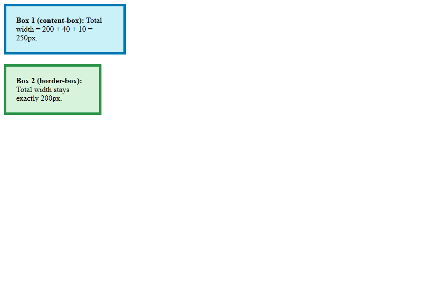
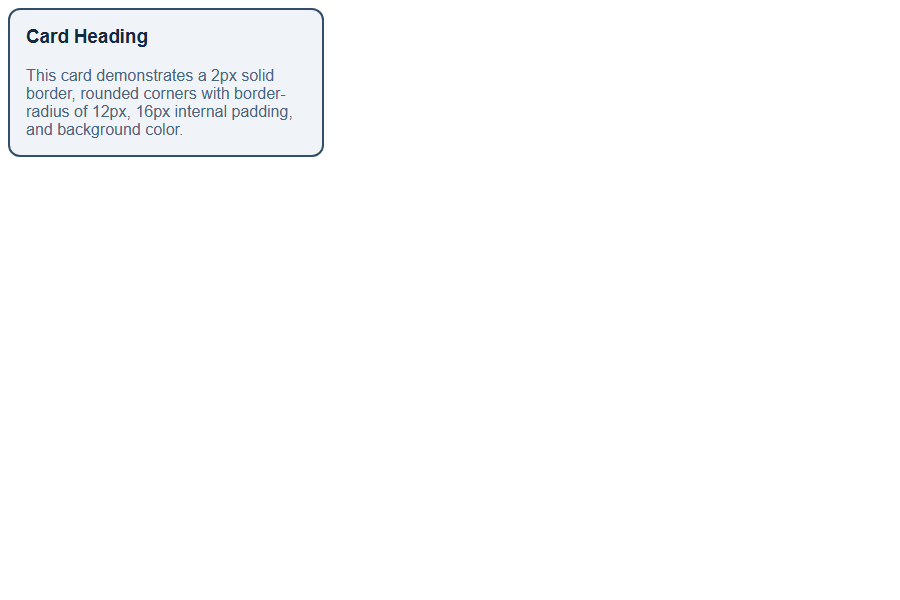
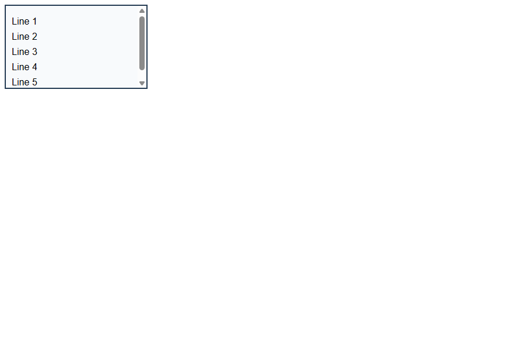

# Assignment 12 - Box Model, Cards and Scrolling

## 1. Aim
Compare content-box and border-box, build a styled card, and add a scrolling box.

## 2. Theoretical Background
- **CSS Box Model**: Composed of content, padding, border, and margin.
  - `content-box` (default): Width and height apply to content only; padding and border add to the element's rendered size.
  - `border-box`: Width and height include content, padding, and border.
- **Card UI**: Utilizes border, padding, border-radius, and box-shadow to create a card component.
- **Overflow Control**: `overflow: auto` adds scrollbars only when content exceeds the container boundaries.

## 3. Tasks Breakdown
- **Task 1 (`box-model.html`)**: Two boxes with identical width, height, padding, and border, contrasting `box-sizing: content-box` vs `border-box`.
- **Task 2 (`card.html`)**: Styled `.card` element with a border, 16px padding, rounded corners (`border-radius`), a light shadow (`box-shadow`), a heading, and two sentences.
- **Task 3 (`scroll.html`)**: Fixed 200px by 200px box with `overflow: auto` and enough text to produce a vertical scrollbar.

## 4. Code Listings

### box-model.html
```html
<!--
Student Name: Ramandeep Kaur
Roll Number : BCS2025395
Course      : B.Tech CSE - Second Year
Subject     : HTML and CSS Introduction Lab (BCS352)
Assignment  : Assignment 12 - Box Model, Cards and Scrolling - Task 1
-->
<!DOCTYPE html>
<html lang="en">
<head>
    <meta charset="UTF-8">
    <meta name="viewport" content="width=device-width, initial-scale=1.0">
    <title>Assignment 12 - Box Model</title>
    <style>
        .box1 {
            width: 200px;
            padding: 20px;
            border: 5px solid #0077b6;
            box-sizing: content-box;
            background-color: #caf0f8;
            margin-bottom: 20px;
        }
        .box2 {
            width: 200px;
            padding: 20px;
            border: 5px solid #2b9348;
            box-sizing: border-box;
            background-color: #d8f3dc;
        }
    </style>
</head>
<body>
    <div class="box1">
        <strong>Box 1 (content-box):</strong> Total width = 200 + 40 + 10 = 250px.
    </div>
    <div class="box2">
        <strong>Box 2 (border-box):</strong> Total width stays exactly 200px.
    </div>
</body>
</html>

```

### card.html
```html
<!--
Student Name: Ramandeep Kaur
Roll Number : BCS2025395
Course      : B.Tech CSE - Second Year
Subject     : HTML and CSS Introduction Lab (BCS352)
Assignment  : Assignment 12 - Box Model, Cards and Scrolling - Task 2
-->
<!DOCTYPE html>
<html lang="en">
<head>
    <meta charset="UTF-8">
    <meta name="viewport" content="width=device-width, initial-scale=1.0">
    <title>Assignment 12 - Card Component</title>
    <style>
        .card {
            background-color: #f0f4f8;
            border: 2px solid #334e68;
            border-radius: 12px;
            padding: 16px;
            width: 280px;
            font-family: Arial, sans-serif;
        }
        .card h3 {
            margin-top: 0;
            color: #102a43;
        }
        .card p {
            margin-bottom: 0;
            color: #486581;
        }
    </style>
</head>
<body>
    <div class="card">
        <h3>Card Heading</h3>
        <p>This card demonstrates a 2px solid border, rounded corners with border-radius of 12px, 16px internal padding, and background color.</p>
    </div>
</body>
</html>

```

### scroll.html
```html
<!--
Student Name: Ramandeep Kaur
Roll Number : BCS2025395
Course      : B.Tech CSE - Second Year
Subject     : HTML and CSS Introduction Lab (BCS352)
Assignment  : Assignment 12 - Box Model, Cards and Scrolling - Task 3
-->
<!DOCTYPE html>
<html lang="en">
<head>
    <meta charset="UTF-8">
    <meta name="viewport" content="width=device-width, initial-scale=1.0">
    <title>Assignment 12 - Scrollable Box</title>
    <style>
        .scroll-box {
            height: 120px;
            overflow: auto;
            border: 2px solid #243b53;
            padding: 10px;
            width: 220px;
            background-color: #f8fafc;
            font-family: Arial, sans-serif;
        }
        .scroll-box p {
            margin: 8px 0;
        }
    </style>
</head>
<body>
    <div class="scroll-box">
        <p>Line 1</p>
        <p>Line 2</p>
        <p>Line 3</p>
        <p>Line 4</p>
        <p>Line 5</p>
    </div>
</body>
</html>

```

## 5. Output Verification

### Task 1: Box-Sizing Comparison (`box-model.html`)
Browser output comparing content-box vs border-box dimensions:



### Task 2: Card UI Component (`card.html`)
Browser output displaying styled card with padding, border radius, and shadow:



### Task 3: Scrollable Overflow Box (`scroll.html`)
Browser output displaying fixed box with overflow scrollbar:



## 6. Conclusion
Box-sizing properties were analyzed, a card with shadow and padding was built, and overflow auto scrollbars were verified.
