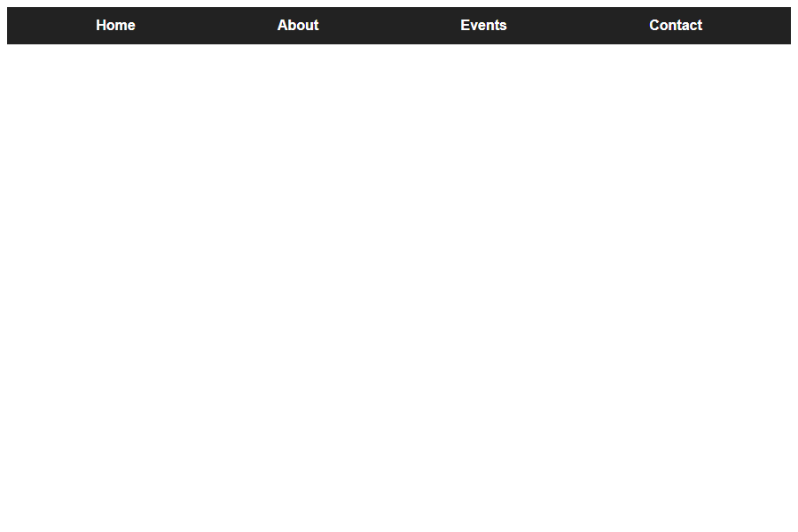
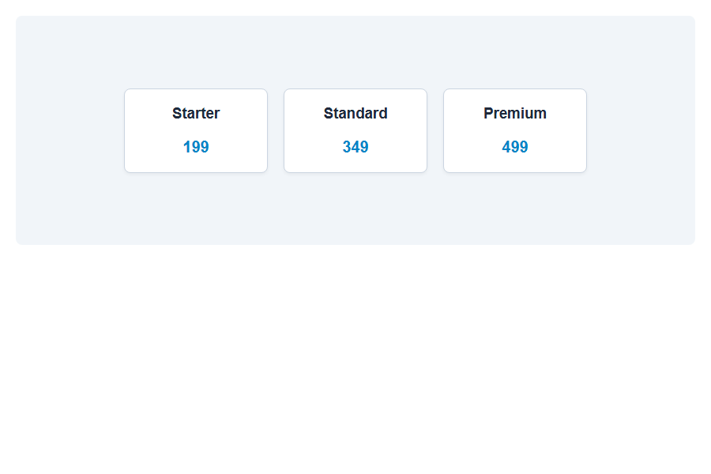
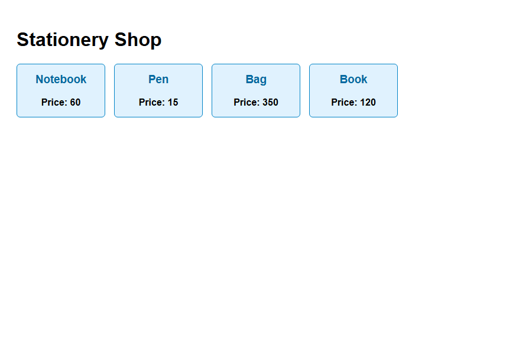

# Assignment 13 - Flexbox Layouts

## 1. Aim
Build a navigation bar, centre a card, and make a row of cards that wrap.

## 2. Theoretical Background
- **Flexbox (`display: flex`)**: One-dimensional layout module for distributing space and aligning items.
  - `justify-content`: Aligns items along the main axis (`space-between`, `center`).
  - `align-items`: Aligns items along the cross axis (`center`).
  - `flex-wrap: wrap`: Allows flex items to break into multiple rows when available space is filled.

## 3. Tasks Breakdown
- **Task 1 (`nav-flex.html`)**: Navigation bar with four links using `display: flex` and `justify-content: space-between` to space items across the page.
- **Task 2 (`centred-cards.html`)**: Container with one card div placed in the exact centre of the window using `justify-content: center` and `align-items: center`.
- **Task 3 (`wrapping-cards.html`)**: Container with six small card divs (150px wide) that wrap into multiple rows as the screen resizes.

## 4. Code Listings

### centred-cards.html
```html
<!--
Student Name: Ramandeep Kaur
Roll Number : BCS2025395
Course      : B.Tech CSE - Second Year
Subject     : HTML and CSS Introduction Lab (BCS352)
Assignment  : Assignment 13 - Flexbox Layouts - Task 2
-->
<!DOCTYPE html>
<html lang="en">
<head>
    <meta charset="UTF-8">
    <meta name="viewport" content="width=device-width, initial-scale=1.0">
    <title>Assignment 13 - Centred Cards</title>
    <style>
        body {
            font-family: Arial, sans-serif;
            margin: 0;
            padding: 20px;
        }
        .row {
            display: flex;
            justify-content: center;
            align-items: center;
            gap: 20px;
            min-height: 250px;
            background-color: #f1f5f9;
            padding: 20px;
            border-radius: 8px;
        }
        .card {
            background-color: #ffffff;
            border: 1px solid #cbd5e1;
            border-radius: 8px;
            padding: 20px;
            text-align: center;
            width: 140px;
            box-shadow: 0 2px 4px rgba(0,0,0,0.05);
        }
        .card h3 {
            margin-top: 0;
            color: #1e293b;
        }
        .card p {
            font-size: 1.25rem;
            font-weight: bold;
            color: #0284c7;
            margin-bottom: 0;
        }
    </style>
</head>
<body>
    <div class="row">
        <div class="card">
            <h3>Starter</h3>
            <p>199</p>
        </div>
        <div class="card">
            <h3>Standard</h3>
            <p>349</p>
        </div>
        <div class="card">
            <h3>Premium</h3>
            <p>499</p>
        </div>
    </div>
</body>
</html>

```

### nav-flex.html
```html
<!--
Student Name: Ramandeep Kaur
Roll Number : BCS2025395
Course      : B.Tech CSE - Second Year
Subject     : HTML and CSS Introduction Lab (BCS352)
Assignment  : Assignment 13 - Flexbox Layouts - Task 1
-->
<!DOCTYPE html>
<html lang="en">
<head>
    <meta charset="UTF-8">
    <meta name="viewport" content="width=device-width, initial-scale=1.0">
    <title>Assignment 13 - Flexbox Navigation Bar</title>
    <style>
        nav {
            display: flex;
            background-color: #222222;
            padding: 12px 20px;
            justify-content: space-around;
            font-family: Arial, sans-serif;
        }
        nav a {
            color: #ffffff;
            text-decoration: none;
            font-weight: bold;
        }
    </style>
</head>
<body>
    <nav>
        <a href="#home">Home</a>
        <a href="#about">About</a>
        <a href="#events">Events</a>
        <a href="#contact">Contact</a>
    </nav>
</body>
</html>

```

### wrapping-cards.html
```html
<!--
Student Name: Ramandeep Kaur
Roll Number : BCS2025395
Course      : B.Tech CSE - Second Year
Subject     : HTML and CSS Introduction Lab (BCS352)
Assignment  : Assignment 13 - Flexbox Layouts - Task 3
-->
<!DOCTYPE html>
<html lang="en">
<head>
    <meta charset="UTF-8">
    <meta name="viewport" content="width=device-width, initial-scale=1.0">
    <title>Assignment 13 - Wrapping Cards</title>
    <style>
        body {
            font-family: Arial, sans-serif;
            padding: 20px;
        }
        .row {
            display: flex;
            flex-wrap: wrap;
            gap: 15px;
        }
        .card {
            background-color: #e0f2fe;
            border: 1px solid #0284c7;
            border-radius: 6px;
            padding: 15px;
            width: 150px;
            text-align: center;
            box-sizing: border-box;
        }
        .card h3 {
            margin-top: 0;
            color: #0369a1;
        }
        .card p {
            margin-bottom: 0;
            font-weight: bold;
        }
    </style>
</head>
<body>
    <h1>Stationery Shop</h1>
    <div class="row">
        <div class="card">
            <h3>Notebook</h3>
            <p>Price: 60</p>
        </div>
        <div class="card">
            <h3>Pen</h3>
            <p>Price: 15</p>
        </div>
        <div class="card">
            <h3>Bag</h3>
            <p>Price: 350</p>
        </div>
        <div class="card">
            <h3>Book</h3>
            <p>Price: 120</p>
        </div>
    </div>
</body>
</html>

```

## 5. Output Verification

### Task 1: Flexbox Navigation Bar (`nav-flex.html`)
Browser output displaying space-between navigation items:



### Task 2: Centered Card (`centred-cards.html`)
Browser output displaying perfectly centered card in viewport:



### Task 3: Wrapping Card Grid (`wrapping-cards.html`)
Browser output displaying responsive wrapping card layout:



## 6. Conclusion
Mastered flex navigation bar distribution, two-axis centering, and multi-row flex-wrapping cards.
