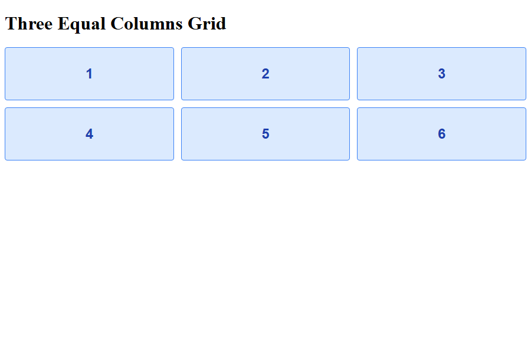
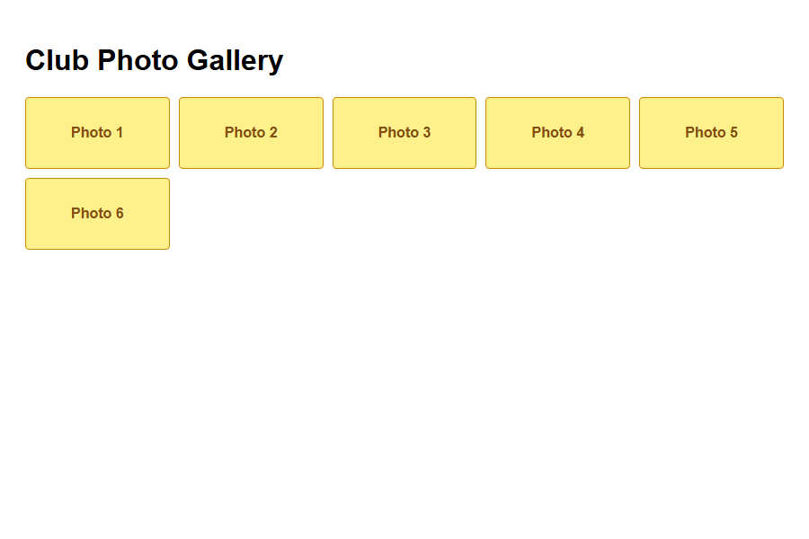
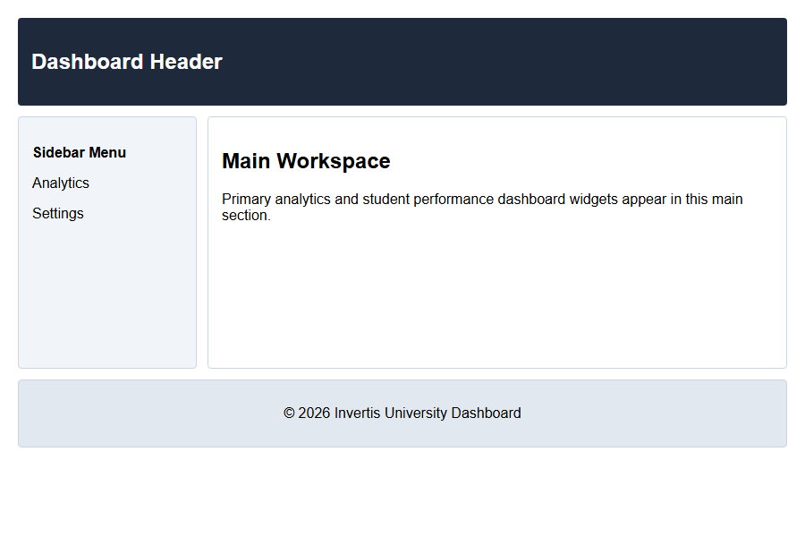

# Assignment 14 - CSS Grid Layouts

## 1. Aim
Make a grid with equal columns, a responsive gallery and a layout with named areas.

## 2. Theoretical Background
- **CSS Grid (`display: grid`)**: A powerful two-dimensional grid-based layout system handling both columns and rows.
- **Fractional Units (`1fr`)**: Represents a fraction of the available space inside the grid container.
- **`repeat(3, 1fr)`**: Concise function generating three columns of equal width.
- **Dynamic Columns (`repeat(auto-fill, minmax(150px, 1fr))`): Allows grid items to wrap and adapt smoothly to the container's width.
- **Named Grid Areas (`grid-template-areas`)**: Declarative syntax mapping child element grid areas to defined layout slots (header, sidebar, main, footer).

## 3. Tasks Breakdown
- **Task 1 (`grid-first.html`)**: Six boxes showing numbers 1 to 6 in a grid of three equal columns with a gap of 12px.
- **Task 2 (`gallery.html`)**: Heading "Club Photo Gallery" with six boxes labelled Photo 1 to Photo 6, using `repeat(auto-fill, minmax(150px, 1fr))` and a gap of 10px.
- **Task 3 (`dashboard-areas.html`)**: Multi-area dashboard grid with two columns (200px and 1fr) using `grid-template-areas`.

## 4. Code Listings

### grid-first.html
```html
<!--
Student Name: Ramandeep Kaur
Roll Number : BCS2025395
Course      : B.Tech CSE - Second Year
Subject     : HTML and CSS Introduction Lab (BCS352)
Assignment  : Assignment 14 - CSS Grid Layouts - Task 1
-->
<!DOCTYPE html>
<html lang="en">
<head>
    <meta charset="UTF-8">
    <meta name="viewport" content="width=device-width, initial-scale=1.0">
    <title>Assignment 14 - Grid First</title>
    <style>
        .grid-container {
            display: grid;
            grid-template-columns: repeat(3, 1fr);
            gap: 12px;
            font-family: Arial, sans-serif;
        }
        .box {
            background-color: #dbeafe;
            border: 1px solid #3b82f6;
            padding: 30px;
            text-align: center;
            font-size: 1.5rem;
            font-weight: bold;
            color: #1e40af;
            border-radius: 4px;
        }
    </style>
</head>
<body>
    <h1>Three Equal Columns Grid</h1>
    <div class="grid-container">
        <div class="box">1</div>
        <div class="box">2</div>
        <div class="box">3</div>
        <div class="box">4</div>
        <div class="box">5</div>
        <div class="box">6</div>
    </div>
</body>
</html>

```

### gallery.html
```html
<!--
Student Name: Ramandeep Kaur
Roll Number : BCS2025395
Course      : B.Tech CSE - Second Year
Subject     : HTML and CSS Introduction Lab (BCS352)
Assignment  : Assignment 14 - CSS Grid Layouts - Task 2
-->
<!DOCTYPE html>
<html lang="en">
<head>
    <meta charset="UTF-8">
    <meta name="viewport" content="width=device-width, initial-scale=1.0">
    <title>Assignment 14 - Gallery</title>
    <style>
        body {
            font-family: Arial, sans-serif;
            padding: 20px;
        }
        .gallery {
            display: grid;
            grid-template-columns: repeat(auto-fill, minmax(150px, 1fr));
            gap: 10px;
        }
        .photo-box {
            background-color: #fef08a;
            border: 1px solid #ca8a04;
            padding: 30px 10px;
            text-align: center;
            font-weight: bold;
            color: #854d0e;
            border-radius: 4px;
        }
    </style>
</head>
<body>
    <h1>Club Photo Gallery</h1>
    <div class="gallery">
        <div class="photo-box">Photo 1</div>
        <div class="photo-box">Photo 2</div>
        <div class="photo-box">Photo 3</div>
        <div class="photo-box">Photo 4</div>
        <div class="photo-box">Photo 5</div>
        <div class="photo-box">Photo 6</div>
    </div>
</body>
</html>

```

### dashboard-areas.html
```html
<!--
Student Name: Ramandeep Kaur
Roll Number : BCS2025395
Course      : B.Tech CSE - Second Year
Subject     : HTML and CSS Introduction Lab (BCS352)
Assignment  : Assignment 14: CSS Grid Layouts - Task 3 (Dashboard Layout with Grid Areas)
-->
<!DOCTYPE html>
<html lang="en">
<head>
    <meta charset="UTF-8">
    <meta name="viewport" content="width=device-width, initial-scale=1.0">
    <title>Dashboard Areas Layout</title>
    <style>
        body {
            margin: 0;
            font-family: Arial, sans-serif;
            padding: 20px;
        }
        .container {
            display: grid;
            grid-template-columns: 200px 1fr;
            grid-template-rows: auto 1fr auto;
            grid-template-areas:
                "header  header"
                "sidebar main"
                "footer  footer";
            gap: 12px;
            min-height: 80vh;
        }
        .header {
            grid-area: header;
            background-color: #1e293b;
            color: #ffffff;
            padding: 15px;
            border-radius: 4px;
        }
        .sidebar {
            grid-area: sidebar;
            background-color: #f1f5f9;
            border: 1px solid #cbd5e1;
            padding: 15px;
            border-radius: 4px;
        }
        .main {
            grid-area: main;
            background-color: #ffffff;
            border: 1px solid #cbd5e1;
            padding: 15px;
            border-radius: 4px;
        }
        .footer {
            grid-area: footer;
            background-color: #e2e8f0;
            border: 1px solid #cbd5e1;
            padding: 12px;
            text-align: center;
            border-radius: 4px;
        }
    </style>
</head>
<body>
    <div class="container">
        <header class="header">
            <h2>Dashboard Header</h2>
        </header>
        <aside class="sidebar">
            <p><strong>Sidebar Menu</strong></p>
            <p>Analytics</p>
            <p>Settings</p>
        </aside>
        <main class="main">
            <h2>Main Workspace</h2>
            <p>Primary analytics and student performance dashboard widgets appear in this main section.</p>
        </main>
        <footer class="footer">
            <p>&copy; 2026 Invertis University Dashboard</p>
        </footer>
    </div>
</body>
</html>

```

## 5. Output Verification

### Task 1: Three Equal Columns Grid (`grid-first.html`)
Browser output displaying six numbered boxes in two rows of three equal columns:



### Task 2: Responsive Auto-Fill Gallery (`gallery.html`)
Browser output displaying six photo boxes in an adaptive auto-fill responsive grid:



### Task 3: Grid Template Areas Dashboard (`dashboard-areas.html`)
Browser output displaying multi-area dashboard with header, sidebar, main, and footer:



## 6. Conclusion
CSS Grid was successfully implemented to create two-dimensional layouts, responsive auto-filling galleries, and semantic multi-area dashboards.
