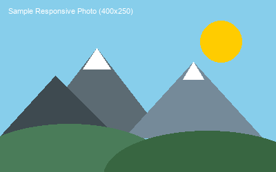
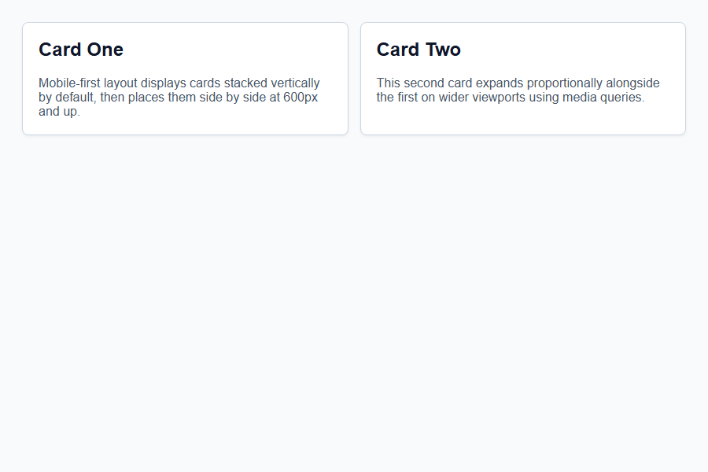
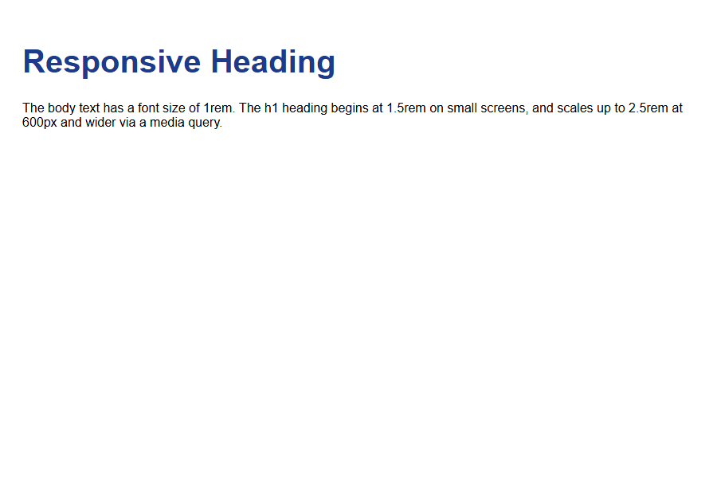
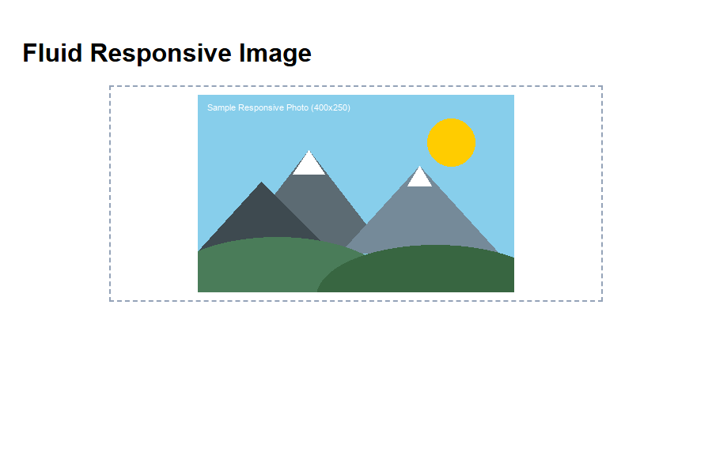

# Assignment 15 - Responsive Pages with Media Queries

## 1. Aim
Use a viewport meta tag, write a mobile-first rule, scale text with rem, and make an image fluid.

## 2. Theoretical Background
- **Viewport Meta Tag**: Configures width and scaling for mobile browsers (`width=device-width, initial-scale=1.0`).
- **Mobile-First Design**: Styling the default layout for smaller viewports and enhancing for desktop via `@media (min-width: ...)`.
- **Responsive Typography**: Scaling the root `font-size` with media queries so all `rem` values adapt smoothly.
- **Fluid Images**: Applying `max-width: 100%` and `height: auto` so images never overflow their parent container.

## 3. Tasks Breakdown
- **Task 1 (`mobile-first.html`)**: Single-column card layout by default, switching to two columns at `@media (min-width: 600px)`.
- **Task 2 (`responsive-text.html`)**: Typography using `rem` units with a `@media (min-width: 768px)` rule increasing root font-size.
- **Task 3 (`responsive-image.html`)**: Image styled with `max-width: 100%` and `height: auto` inside a container.

## 4. Code Listings

### mobile-first.html
```html
<!--
Student Name: Ramandeep Kaur
Roll Number : BCS2025395
Course      : B.Tech CSE - Second Year
Subject     : HTML and CSS Introduction Lab (BCS352)
Assignment  : Assignment 15 - Responsive Pages with Media Queries - Task 1
-->
<!DOCTYPE html>
<html lang="en">
<head>
    <meta charset="UTF-8">
    <meta name="viewport" content="width=device-width, initial-scale=1.0">
    <title>Assignment 15 - Mobile First Cards</title>
    <style>
        body {
            font-family: Arial, sans-serif;
            padding: 20px;
            background-color: #f8fafc;
        }
        .cards {
            display: flex;
            flex-direction: column;
            gap: 15px;
        }
        .card {
            background-color: #ffffff;
            border: 1px solid #cbd5e1;
            border-radius: 8px;
            padding: 20px;
            box-shadow: 0 2px 4px rgba(0, 0, 0, 0.05);
        }
        .card h2 {
            margin-top: 0;
            color: #0f172a;
        }
        .card p {
            color: #475569;
            margin-bottom: 0;
        }
        @media (min-width: 600px) {
            .cards {
                flex-direction: row;
            }
            .card {
                flex: 1;
            }
        }
    </style>
</head>
<body>
    <div class="cards">
        <div class="card">
            <h2>Card One</h2>
            <p>Mobile-first layout displays cards stacked vertically by default, then places them side by side at 600px and up.</p>
        </div>
        <div class="card">
            <h2>Card Two</h2>
            <p>This second card expands proportionally alongside the first on wider viewports using media queries.</p>
        </div>
    </div>
</body>
</html>

```

### responsive-image.html
```html
<!--
Student Name: Ramandeep Kaur
Roll Number : BCS2025395
Course      : B.Tech CSE - Second Year
Subject     : HTML and CSS Introduction Lab (BCS352)
Assignment  : Assignment 15: Responsive Pages with Media Queries - Task 3 (Fluid Responsive Image)
-->
<!DOCTYPE html>
<html lang="en">
<head>
    <meta charset="UTF-8">
    <meta name="viewport" content="width=device-width, initial-scale=1.0">
    <title>Fluid Responsive Image</title>
    <style>
        body {
            font-family: Arial, sans-serif;
            padding: 20px;
        }
        .image-container {
            width: 80%;
            max-width: 600px;
            margin: 0 auto;
            border: 2px dashed #94a3b8;
            padding: 10px;
            text-align: center;
        }
        .image-container img {
            max-width: 100%;
            height: auto;
            display: block;
            margin: 0 auto;
        }
    </style>
</head>
<body>
    <h1>Fluid Responsive Image</h1>
    <div class="image-container">
        
    </div>
</body>
</html>

```

### responsive-text.html
```html
<!--
Student Name: Ramandeep Kaur
Roll Number : BCS2025395
Course      : B.Tech CSE - Second Year
Subject     : HTML and CSS Introduction Lab (BCS352)
Assignment  : Assignment 15 - Responsive Pages with Media Queries - Task 3
-->
<!DOCTYPE html>
<html lang="en">
<head>
    <meta charset="UTF-8">
    <meta name="viewport" content="width=device-width, initial-scale=1.0">
    <title>Assignment 15 - Responsive Text</title>
    <style>
        body {
            font-family: Arial, sans-serif;
            padding: 20px;
            font-size: 1rem;
        }
        h1 {
            font-size: 1.5rem;
            color: #1e3a8a;
        }
        @media (min-width: 600px) {
            h1 {
                font-size: 2.5rem;
            }
        }
    </style>
</head>
<body>
    <h1>Responsive Heading</h1>
    <p>The body text has a font size of 1rem. The h1 heading begins at 1.5rem on small screens, and scales up to 2.5rem at 600px and wider via a media query.</p>
</body>
</html>

```

## 5. Output Verification

### Task 1: Mobile-First Responsive Cards (`mobile-first.html`)
Browser output displaying mobile-first responsive card layout:



### Task 2: Responsive Fluid Typography (`responsive-text.html`)
Browser output displaying rem typography scaling at media breakpoint:



### Task 3: Responsive Fluid Image (`responsive-image.html`)
Browser output displaying fluid responsive image scaling:



## 6. Conclusion
The viewport meta tag was integrated, mobile-first card layouts switching at 600px were built, root-level responsive rem typography was verified, and fluid image scaling was demonstrated.
